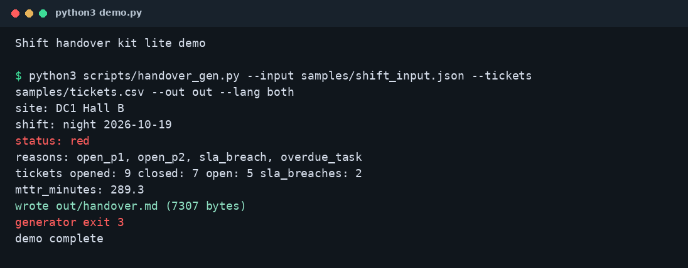

# Shift Handover Report Auto-Generator — Free Lite

## English

Free subset of the Shift Handover Report Auto-Generator. It reads a shift JSON file and a ticket CSV, paints a red / amber / green status, and writes `handover.md`.

Handovers are verbal and inconsistent. Open P1s get lost between shifts. This lite tree still names those P1s, open P2s, SLA breaches, and overdue tasks in one markdown file. Alarm merge, HTML, JSON, and carry-over from the previous report are listed in `reference/FULL_PACK_ONLY.md`.

Python 3 standard library only. Synthetic hall only. The sample is supposed to exit 3.

### Quick start

```bash
python3 demo.py
```

`out/handover.md` is the only report. `out/` is gitignored. The captured stdout is [docs/demo_output.txt](docs/demo_output.txt).

```bash
python3 scripts/handover_gen.py \
  --input samples/shift_input.json \
  --tickets samples/tickets.csv \
  --out out \
  --lang both
```

```bash
python3 -m unittest discover -s tests
```

### Demo

On this subset the same night shift is red: open P1, open P2, two SLA breaches, overdue tasks. No alarm line and no carry-over count. The generator exits 3. `demo.py` exits 0 after it records that.

```text
Shift handover kit lite demo

$ python3 scripts/handover_gen.py --input samples/shift_input.json --tickets samples/tickets.csv --out out --lang both
site: DC1 Hall B
shift: night 2026-10-19
status: red
reasons: open_p1, open_p2, sla_breach, overdue_task
tickets opened: 9 closed: 7 open: 5 sla_breaches: 2
mttr_minutes: 289.3
wrote out/handover.md (7307 bytes)
generator exit 3
demo complete
```



### Lite deliverables

- Shift JSON plus ticket CSV in
- Markdown report out
- Red / amber / green status from open P1, open P2, SLA, and overdue tasks
- Bilingual template subset, synthetic night-shift sample, demo, and unit tests

### Full pack deliverables

The full kit is a separate download. This repo does not include it.

- Alarm CSV merge, including an uncleared critical alarm as a red reason
- `handover.html` and `handover.json`
- Carry-over flags from the previous handover
- Store cover images
- The same template, sample shape, and RAG rules, with those inputs filled in

### Delivery time

Full kit: instant download. Setup about 5 minutes. Adapting the template and fields to your site about 30 minutes.

This lite repo: clone and run the command above. The sample check finishes in seconds.

Pay what you want, $1 or more. Suggested price is $3.

### Links

Full version on Gumroad: GUMROAD_URL

Full n8n DevOps pack, $9: https://caoyadong.gumroad.com/l/yvmcqj

BMC/IPMI kit: https://caoyadong.gumroad.com/l/dzmww

### License

MIT. Copyright (c) 2026 caoyadong888-wq. See [LICENSE](LICENSE).

## 中文

这是「交接班报告自动生成器」的免费精简版。它读班次 JSON 和工单 CSV，涂红 / 琥珀 / 绿，并写出 `handover.md`。

交接靠口头，写法也不一致。未关闭的 P1 换班时会丢。精简版仍把这些 P1、未关闭的 P2、超出时限和逾期任务写进一份 Markdown。告警合并、HTML、JSON，以及从上一份报告承接，列在 `reference/FULL_PACK_ONLY.md`。

只用 Python 3 标准库。机房是合成的。示例退出码应为 3。

### 快速开始

```bash
python3 demo.py
```

只生成 `out/handover.md`。`out/` 已被忽略。同一次运行的标准输出在 [docs/demo_output.txt](docs/demo_output.txt)。

```bash
python3 scripts/handover_gen.py \
  --input samples/shift_input.json \
  --tickets samples/tickets.csv \
  --out out \
  --lang both
```

```bash
python3 -m unittest discover -s tests
```

### 演示

在这个子集上，同一夜班是红色：未关闭的 P1、未关闭的 P2、两笔超出时限、逾期任务。没有告警行，也没有承接计数。生成器退出码 3。`demo.py` 记下这个退出码之后以 0 结束。上面英文代码块就是这次运行的标准输出。


### 精简版交付物

- 输入是班次 JSON 和工单 CSV
- 输出是 Markdown 报告
- 红 / 琥珀 / 绿来自未关闭的 P1、未关闭的 P2、时限和逾期任务
- 中英模板子集、合成夜班样例、演示和单元测试

### 完整包交付物

完整包单独下载。本仓库不含这些额外能力。

- 告警 CSV 合并，未清除的严重告警作为红色原因
- `handover.html` 和 `handover.json`
- 从上一份交接报告标承接
- 商店封面
- 同一套模板、样例形状和红黄绿规则，把这些输入补上

### 交付时间

完整包：下载即得。安装并跑通大约 5 分钟。把模板和字段改成你的站点大约 30 分钟。

本精简版：克隆后运行上面的命令即可。示例几秒内结束。

愿付多少付多少，1 美元起，建议 3 美元。

### 链接

完整版 Gumroad：GUMROAD_URL

完整 n8n DevOps 包，9 美元：https://caoyadong.gumroad.com/l/yvmcqj

BMC/IPMI 工具包：https://caoyadong.gumroad.com/l/dzmww

### 许可证

MIT。Copyright (c) 2026 caoyadong888-wq。见 [LICENSE](LICENSE)。
